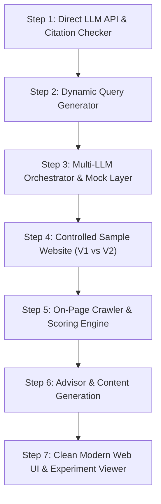

# AI Visibility & GEO Analyzer - Step-by-Step Rebuild Plan

## 1. Project Goal & Philosophy
The goal is to rebuild the **AI Visibility & Generative Engine Optimization (GEO) Analyzer** from the ground up with clean, modular, and easy-to-understand code.

Instead of a monolith, we build each piece as an independent, testable module with clear inputs and outputs. We also implement a **closed-loop demonstration**:
> **The Controlled Experiment**:
> 1. Launch a sample baseline website with known GEO flaws (no schema, no stats, vague content, blocked AI bots).
> 2. Run the analyzer to measure baseline visibility, crawl signals, and citation gaps.
> 3. Use the advisor's feedback to update the website (adding JSON-LD schema, direct answer headings, citable statistics, and unblocking AI crawlers).
> 4. Re-run the analyzer to demonstrate a measurable **Before vs. After** jump in GEO score and citation readiness!

---

## 2. Architecture & Directory Structure (Clean & Modular)

```
ai_visibility_analyzer/
├── backend/
│   ├── core/
│   │   ├── config.py             # Environment variables & provider settings
│   │   ├── llm_clients/          # Standardized LLM adapters
│   │   │   ├── base.py           # BaseLLMClient interface
│   │   │   ├── gemini.py         # Google Gemini (with Google Search Grounding)
│   │   │   ├── openai_client.py  # ChatGPT (OpenAI API)
│   │   │   ├── perplexity.py     # Perplexity Sonar (with citation URLs)
│   │   │   ├── claude.py         # Anthropic Claude
│   │   │   └── mock.py           # Deterministic offline mock (0-cost testing)
│   │   ├── query_engine.py       # Dynamic query generation (discovery vs. branded)
│   │   ├── citation_checker.py   # Citation extractor & domain matcher
│   │   ├── crawler.py            # On-page GEO signals (schema, robots.txt, stats)
│   │   ├── scorer.py             # AI Visibility, GEO score & Share of Voice formulas
│   │   └── advisor.py            # Evidence-based recommendations & content generator
│   ├── sample_site/              # Sample website for Before vs After experiments
│   │   ├── baseline/             # V1: Un-optimized website
│   │   └── optimized/            # V2: GEO-optimized website with schema & citable stats
│   ├── api/
│   │   ├── main.py               # FastAPI entry point
│   │   └── routes/               # Clean endpoint routers
│   └── tests/                    # Step-by-step verification scripts
└── frontend/                     # Clean, modern UI (Dashboard + Experiment Viewer)
```

---

## 3. Implementation Phases & Milestones



### Step 1: Single LLM API & Citation Checking (Immediate Next Step)
* **Objective**: Send a sample query to an LLM, inspect the response, and check if a specific website is cited or mentioned.
* **Deliverables**:
  1. `backend/core/llm_clients/base.py`: Standard output format (`text`, `citations`, `metadata`).
  2. `backend/core/llm_clients/gemini.py`: Implementation using Gemini with Google Search Grounding enabled (returns grounded web source citations).
  3. `backend/core/citation_checker.py`: Checks if target domain appears in:
     - The raw response text (brand name, domain, hyphenated variants).
     - The citation/source URLs.
     - Position detection (Early, Mid, Late).
  4. Test script `tests/test_step1_citation.py` verifying detection against a real or sample query.

---

### Step 2: Dynamic Query Generator
* **Objective**: Generate diverse, realistic customer buying-intent prompts from seed keywords without hardcoding prompts.
* **Separation of Concerns**:
  - **Discovery Queries** (Unbranded): e.g., *"What is the best [keyword] for [persona] in 2026?"*, *"Top alternatives to [competitor]"*. Never names the brand. Used to calculate true organic AI Visibility.
  - **Branded Queries** (Reputation): e.g., *"Is [brand] good for [keyword]?"*, *"[brand] vs [competitor]"*. Used to assess sentiment and specific claims.
* **Deliverables**:
  - `backend/core/query_engine.py` with persona matrix (SaaS, E-commerce, Healthcare, Local, etc.) and intent templates (best-of, comparison, alternatives, budget).

---

### Step 3: Multi-LLM Orchestrator & Mock Engine
* **Objective**: Concurrently query multiple LLM providers (Gemini, ChatGPT, Perplexity, Claude).
* **Deliverables**:
  - Standardized adapters for OpenAI, Perplexity, and Claude.
  - Offline Mock Engine (`mock.py`): Enables full offline testing without API keys.
  - Thread pool / async execution with configurable timeouts and repeats (for measuring answer consistency).

---

### Step 4: Controlled Sample Website (The Closed-Loop Experiment)
* **Objective**: Create a controlled sample website to demonstrate how GEO directly transforms a brand's visibility.
* **Implementation**:
  - **Scenario**: A modern product (e.g. *AuraNotes* - an AI audio note taker, or *Zenith Clean* - an organic cleaning brand).
  - **Baseline Version (`sample_site/baseline`)**:
    - Thin text, marketing buzzwords.
    - No JSON-LD schema.
    - `robots.txt` blocking AI bots (`User-agent: GPTBot Disallow: /`).
    - No FAQ section or question headings.
    - Zero statistics or verifiable data points.
  - **Optimized Version (`sample_site/optimized`)**:
    - Structured data (`SoftwareApplication`, `Organization`, `FAQPage`).
    - `robots.txt` allowing AI crawlers.
    - Direct answer snippets (H2 question followed by crisp 40-50 word direct answer).
    - Citable benchmarks (e.g., "Transcribes audio 4.2x faster with 98.7% accuracy").
    - Clear author byline and published/modified dates.

---

### Step 5: On-Page GEO Crawler & Scoring Engine
* **Objective**: Measure on-page AI readability and calculate visibility metrics.
* **Metrics**:
  - **AI Visibility Score** $= 70\% \times \text{Mention Rate} + 30\% \times \text{Citation Rate} \pm \text{Sentiment Bonus}$.
  - **On-Page GEO Score**: Weighted score of structured schema, direct answers, crawler access, data density, and author trust.
  - **Share of Voice**: Brand mentions vs competitor mentions.

---

### Step 6: Evidence-Grounded Advisor & Content Studio
* **Objective**: Provide prioritized recommendations and automatically draft content to capture lost queries.
* **Deliverables**:
  - **Diagnostic Advisor**: Maps failures to concrete action items (e.g., *"E1: robots.txt blocks GPTBot -> Fix: Allow GPTBot"*).
  - **Citation Gaps**: Identifies third-party platforms (G2, Capterra, Reddit) where competitors are cited.
  - **GEO Content Writer**: Generates comprehensive comparison guides, FAQs, or listicles targeting the exact queries the brand lost.

---

### Step 7: Clean, Modern Frontend UI
* **Objective**: Interactive, beautiful dashboard to run analyses and visualize the before/after experiment.
* **Key Views**:
  1. **Experiment Showcase**: Side-by-side view of the Sample Website (Baseline vs Optimized) showing the score evolution.
  2. **Audit Dashboard**: Real-time progress bar, score rings, per-assistant breakdown, and query table.
  3. **Content & Action Studio**: Step-by-step fix recommendations and AI blog generator.

---

## 4. Immediate Next Actions

1. Review and approve this plan.
2. Begin **Step 1**: Implement `backend/core/llm_clients/base.py`, `gemini.py` (with Search Grounding), and `citation_checker.py`.
3. Run a test script to see citation checking in action with a live query.
